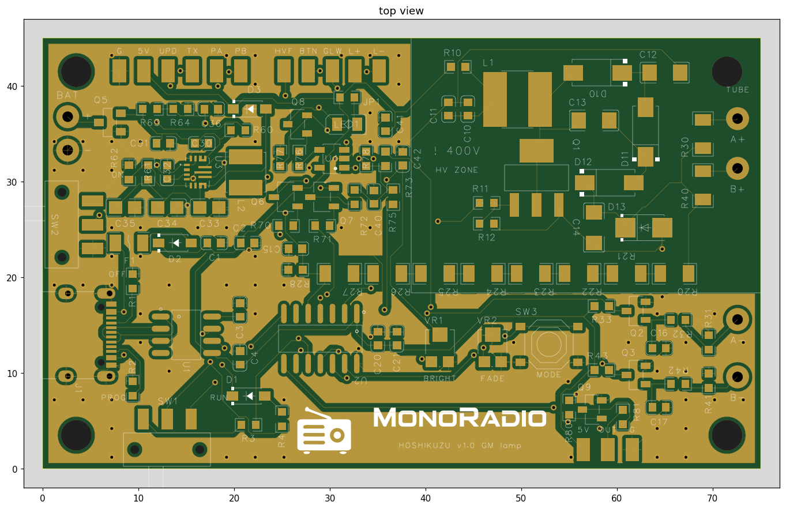

<div align="center">

# 星屑灯

**STARDUST LAMP**

宇宙から降ってきた粒子が 2 本の管を貫いたとき、ふわりと灯るランプ。

[Web モニター](https://monoradio102.github.io/stardust-lamp/)　·　[回路と基板](hardware/)　·　[ファーム](firmware/stardust/)

<br>



</div>

<br>

## しくみ

上下に重ねた 2 本の GM 管（ガイガー・ミュラー管）が、**同時に**反応したときだけ光ります。

身のまわりの放射線（ガンマ線）は、ふつう 1 本の管しか反応させません。2 本をまとめて突き抜けていくのは、地上ではほとんどが宇宙線のミューオンです。2 本のパルスが重なった一瞬だけコンデンサに電荷が入り、その電荷がそのまま LED の光になって、ゆっくり消えていきます。

| | |
|---|---|
| 光る回数 | 1 分に 2〜3 回ほど（管を横に並べると約 3 分の 1 に減る） |
| 管 | J321 × 2 |
| 電源 | USB-C、または単三・単四 2 本で 6 日ほど |
| 光り方 | 宇宙線（2 本同時） / 放射線（1 本ごと） / デジタル |

> わたくしといふ現象は／仮定された有機交流電燈の／ひとつの青い照明です
> — 宮沢賢治『春と修羅』序（基板の裏に縦書きで）

## Web モニター

**https://monoradio102.github.io/stardust-lamp/**

基板を USB でパソコンにつなぐと、ブラウザで反応を見たり、記録したり、設定を変えたりできます。

- 管が反応した瞬間、画面の管が光る。2 本同時なら光の線が貫く
- 宇宙線の数、管ごとの数、高圧、電池の数字とグラフ（10 分〜7 日）
- 10 秒ごとの記録データと、1 ms 単位のイベントの流れ
- 光り方・高圧・同時の幅などの設定、プラトー測定、2 本の時間差の分布
- 記録はそのブラウザの中にだけ残り、どこにも送られません

**使い方**

1. パソコンの **Chrome か Edge** で開く（Web シリアルを使うため。Safari・Firefox・スマホは非対応）
2. 基板の SW1 を **RUN** にして USB でつなぐ
3. 「基板につなぐ」を押し、USB シリアル（CH340）のポートを選ぶ

つないでいないときは、デモの動きが流れます。

## ファーム

[`firmware/stardust/`](firmware/stardust/) — ATtiny1614、Arduino IDE ＋ megaTinyCore。変更の履歴は [CHANGELOG](firmware/stardust/CHANGELOG.md)、バージョンは git のタグ（`fw-1.4.0` など）。

| ボードの設定 | |
|---|---|
| Chip | ATtiny1614 |
| Clock | 20 MHz internal |
| millis()/micros() Timer | TCA0（TCD0 は高圧の駆動に使う） |
| Programmer | SerialUPDI - 230400 baud |

SW1 を **PROG** にして書き込み、**RUN** に戻してから使います。シリアルのコマンドとログの形は、`stardust.ino` の先頭に書いてあります。

## 回路と基板

[`hardware/`](hardware/) — 回路図（PDF）、基板の図、各部のしくみ、測った結果。

## リポジトリの中身

```
index.html              Web モニター（GitHub Pages）
firmware/stardust/      ファームと変更履歴
hardware/               回路図・基板の図・説明
```

## 安全のために

この基板は GM 管を動かすために **約 400V** の高圧をつくります。動いている間は、高圧部（右上の「! 400V」の中）と管のクリップに触れないでください。止めたあとも、高圧が 10V 未満に下がるまで（10 秒ほど）待ってから触ります。

## ライセンス

[MIT](LICENSE)
