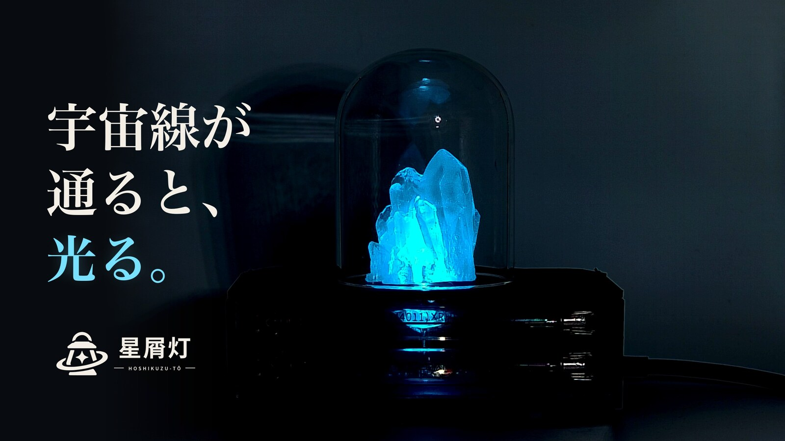
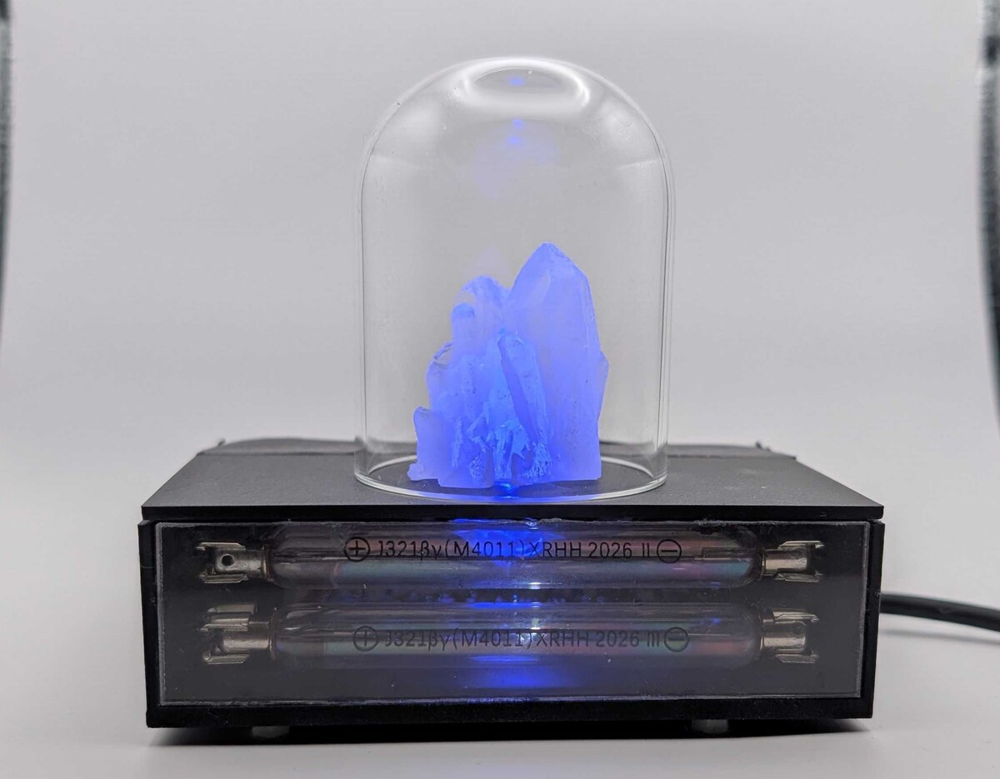
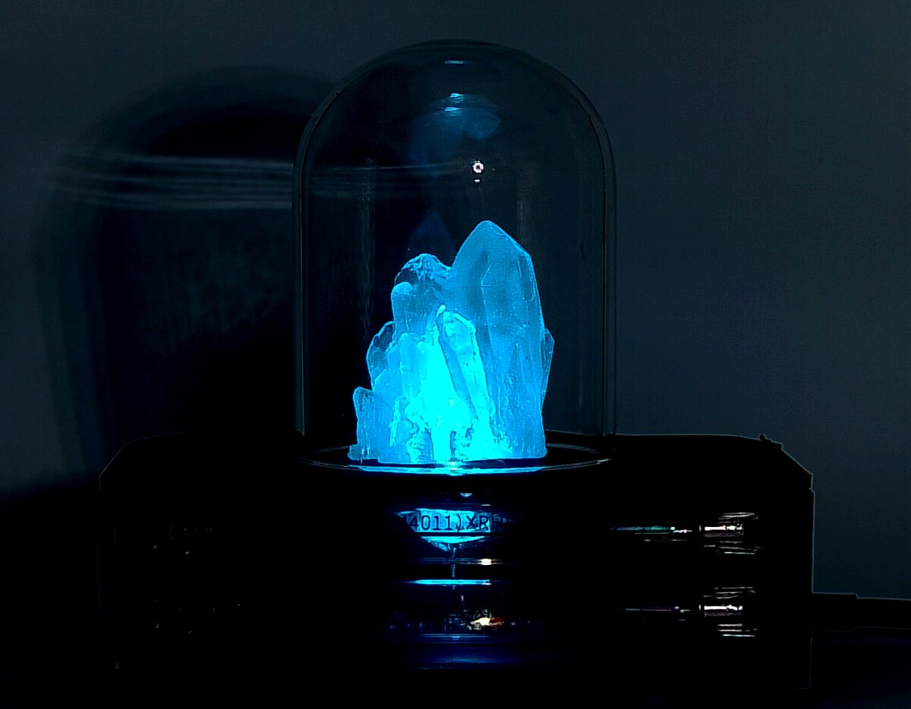
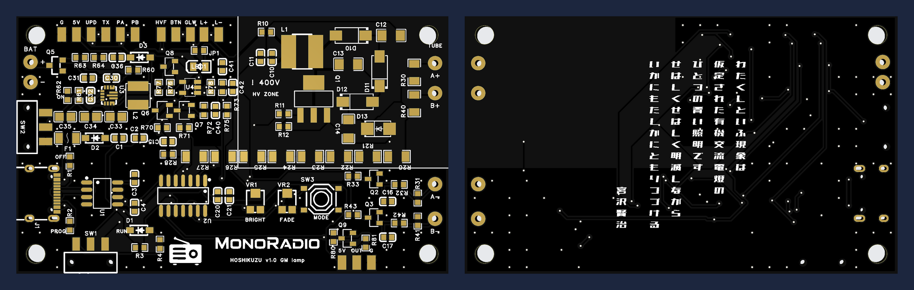

<div align="center">

<picture>
  <source media="(prefers-color-scheme: dark)" srcset="brand/hoshikuzu_stacked_cream.svg">
  
</picture>

<br>

<h3>銀河を旅する星屑が灯す、明かり</h3>

<br>

[紹介動画](https://youtu.be/LIFDgEcAJlk)　·　[Web モニター](https://monoradio102.github.io/stardust-lamp/)　·　[回路と基板](hardware/)　·　[ファーム](firmware/stardust/)


<a href="https://youtu.be/LIFDgEcAJlk"></a>

<br><br>


<p>
星がその一生を終えるとき、超新星爆発が起こります。<br>
その衝撃波で光の速さ近くまで加速された粒子は、<br>
銀河の磁場に導かれて、一千万年もの旅を続けます。
</p>

<p>✦</p>

<p>
地球の大気には、その粒子の雨が降り注いでいます。<br>
上空 15 km で空気の原子核とぶつかり、<br>
粒子は大気に溶けていきます。<br>
そのとき生まれるのが、<br>
ミューオンという小さな粒子です。<br>
ミューオンは今も、あなたの手のひらを<br>
毎秒ひとつずつ通り抜けています。
</p>

<p>✦</p>

<p>
このランプは、そのミューオンがガイガー管に残す<br>
かすかな痕跡を増幅して、<br>
1 分に 2 回ほど、ふわりと灯ります。<br>
銀河を巡った旅の、最後のしるしです。
</p>

<br><br>




<br><br>



<br><br>

</div>


## しくみ

上下に重ねた 2 本の GM 管（ガイガー・ミュラー管）が、**同時に**反応したときだけ光ります。

身のまわりの放射線（ガンマ線）は、ふつう 1 本の管しか反応させません。2 本をまとめて突き抜けていくのは、地上ではほとんどが宇宙線のミューオンです。たまたま別々の反応が重なる偶然の一致は全体の 0.04% ほどなので、光るときの 99.9% 以上は宇宙線です（[観測の記録](research/2026-11-cosmic-rays/)）。

宇宙線モードでは、光はデジタルを通りません。2 本のパルスが重なった一瞬だけコンデンサに電荷が入り、その信号をアナログのまま増幅して LED の光に変えるので、光はゆっくり、なめらかに消えていきます。

| | |
|---|---|
| 光る回数 | 1 分に 2 回ほど（45 時間の記録で平均 1.98 回。管を横に並べると約 3 分の 1 に減る） |
| 管 | J321 × 2 |
| 電源 | USB-C、または単三・単四 2 本で 6 日ほど |
| 光り方 | 宇宙線（2 本同時） / 放射線（1 本ごと） / デジタル |

> わたくしといふ現象は／仮定された有機交流電燈の／ひとつの青い照明です
> — 宮沢賢治『春と修羅』序（基板の裏に縦書きで）

## Web モニター

**https://monoradio102.github.io/stardust-lamp/**

基板を USB でパソコンにつなぐと、ブラウザで反応を見たり、記録したり、設定を変えたりできます。

- 管が反応した瞬間、画面の管が光る。2 本同時なら光の線が貫く
- 宇宙線の数、管ごとの数、高圧、電池の数字とグラフ（10 分〜7 日）
- 10 秒ごとの記録データと、1 ms 単位のイベントの流れ
- 光り方・高圧・同時の幅などの設定、プラトー測定、2 本の時間差の分布
- 記録はそのブラウザの中にだけ残り、どこにも送られません

**使い方**

1. パソコンの **Chrome か Edge** で開く（Web シリアルを使うため。Safari・Firefox・スマホは非対応）
2. 基板の SW1 を **RUN** にして USB でつなぐ
3. 「基板につなぐ」を押し、USB シリアル（CH340）のポートを選ぶ

つないでいないときは、デモの動きが流れます。

## ファーム

[`firmware/stardust/`](firmware/stardust/) — ATtiny1614、Arduino IDE ＋ megaTinyCore。変更の履歴は [CHANGELOG](firmware/stardust/CHANGELOG.md)、バージョンは git のタグ（`fw-1.4.0` など）。

| ボードの設定 | |
|---|---|
| Chip | ATtiny1614 |
| Clock | 20 MHz internal |
| millis()/micros() Timer | TCA0（TCD0 は高圧の駆動に使う） |
| Programmer | SerialUPDI - 230400 baud |

SW1 を **PROG** にして書き込み、**RUN** に戻してから使います。シリアルのコマンドとログの形は、`stardust.ino` の先頭に書いてあります。

## 回路と基板

[`hardware/`](hardware/) — 回路図（PDF）、基板の図、各部のしくみ、測った結果。

## 観測の記録

[星屑灯で、宇宙線を研究する](research/2026-11-cosmic-rays/) — ランプ 1 台でできる 6 つの研究。宇宙線の到来のランダムさ、同時計数法、管の形からの計数率の予言、ミューオンの時間の遅れなど。

## リポジトリの中身

```
index.html              Web モニター（GitHub Pages）
firmware/stardust/      ファームと変更履歴
hardware/               回路図・基板の図・説明
research/               研究レポート（解析のコードと図）
brand/                  ロゴ（SVG。文字もアウトライン化済み）とアイコン
images/                 写真
```

## 安全のために

この基板は GM 管を動かすために **約 400V** の高圧をつくります。動いている間は、高圧部（右上の「! 400V」の中）と管のクリップに触れないでください。止めたあとも、高圧が 10V 未満に下がるまで（10 秒ほど）待ってから触ります。

## ライセンス

[MIT](LICENSE)
