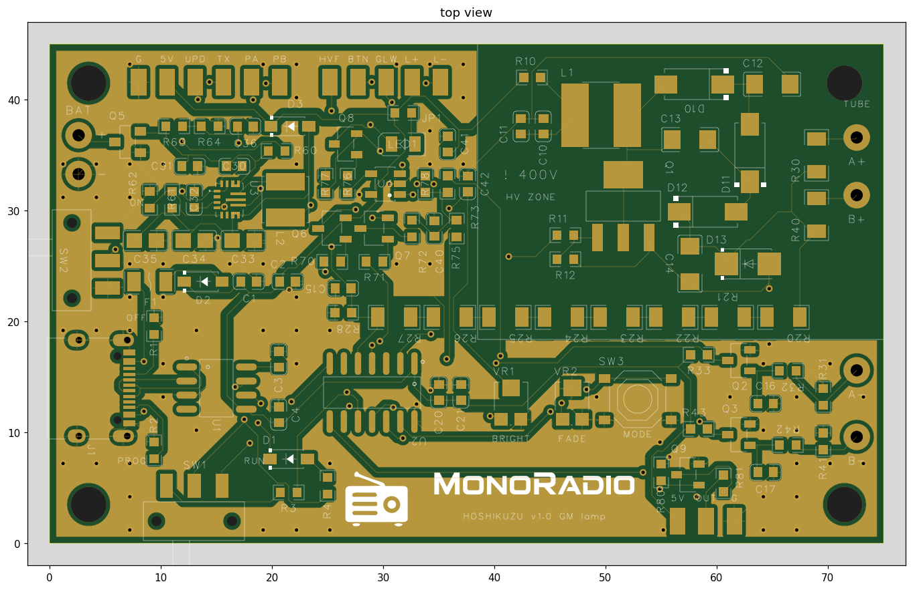
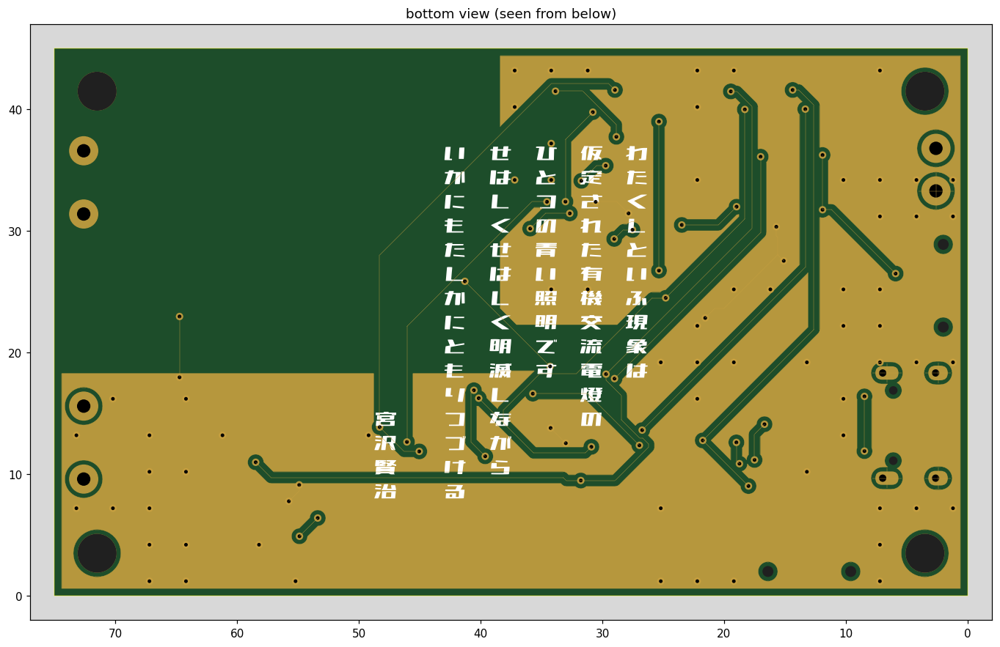

# 回路と基板

星屑灯 v1 の回路と基板のまとめです。回路図は [schematic.pdf](schematic.pdf)（5 ページ）にあります。

<p align="center">
  
  
</p>

| | |
|---|---|
| 基板 | 75 × 45 mm、2 層、部品はすべて表面（JLCPCB の PCBA） |
| GM 管 | J321 × 2（ホルダに載せて線でつなぐ） |
| マイコン | ATtiny1614（megaTinyCore） |
| 電源 | USB-C 5V、または電池 2〜12V（単三・単四 2〜4 本など） |
| 高圧 | 約 360V（330〜450V で設定できる） |
| PC との接続 | USB-C（CH340N）。書き込みとログを同じケーブルで |

## しくみ

```
          宇宙線（ミューオン）
                 │
   ┌─────────────┼─────────────┐
   │  管 A  ═════╪═════         │──→ パルス A ─┐
   │             │              │               ├─→ 重なった間だけ電荷 → 残光の LED
   │  管 B  ═════╪═════         │──→ パルス B ─┘
   └─────────────┼─────────────┘          └────→ マイコンが数えて USB へ
                 ↓
```

- 2 本の管を上下に重ね、**2 本のパルスが重なった間だけ**コンデンサに電荷が入って LED が光ります。粒子の信号が、マイコンを通らずにそのまま光になります
- 身のまわりのガンマ線は、ふつう 1 本の管しか反応させません。2 本をまとめて突き抜けるのは、地上ではほとんどが宇宙線のミューオンです
- マイコンは管ごとの数と 2 本同時の数を数えて、USB にログを出します

## 電源

```
USB-C VBUS ─ PTC 500mA ─ B5819W ─┐
                                  ├─ V5（約 4.4〜4.7V）→ マイコン・CH340N・高圧・LED
BAT+ ─ AO3401A（逆接保護）─ TPS63070（4.68V）─ B5819W ─┘
```

- 電池は左の辺の穴パッド BAT+ / BAT− にはんだ付けします。逆接保護の FET の都合で、12V を超える電池は使えません
- 電源スイッチ SW2 が切るのは電池側だけです。USB をつなぐと、スイッチに関係なく USB から動きます
- USB と電池を両方つなぐと USB から給電され、電池はほとんど減りません

## 高圧電源

```
V5 ─ 10Ω ─ L1 1mH ─ SW ─┬─ D ─ 約 200V
                         │
                   BSP125（ゲート ← マイコン）
                         └─ 倍圧 ─ D ─ HV 約 400V ─┬─ SMAJ440A（約 500V で頭打ち）
                                                    ├─ 10MΩ × 8 ＋ 220k → マイコンの ADC
                                                    ├─ 4.7MΩ → 管 A
                                                    └─ 4.7MΩ → 管 B
```

- 約 200V まで昇圧し、倍圧で約 400V を作ります。マイコンが高圧を読みながらスイッチングを制御します
- 負荷は帰還の分圧（数 µA）だけなので、ファーム 1.3.0 からは、目標より低いときだけスイッチングを回す**バースト駆動**にしています
- 過電圧はファームとツェナー（SMAJ440A）の二重で抑えます
- 帰還の抵抗は放電抵抗も兼ねていて、高圧を止めると約 10 秒で 10V 未満に下がります
- 高圧の線は、ほかの銅から 1.2 mm 以上離しています

## 管の検出

- 管ごとに独立しています。HV → 4.7MΩ → アノード、カソード → 100k → GND
- カソード側の電圧をトランジスタで受けて、マイコンへのパルス（反応中は LOW）にします。マイコンに高圧が来ない作りです

## 残光の LED

```
パルス A ─ PNP ─┐
パルス B ─ PNP ─┴─ 47Ω ─┬─ 2.2µF
マイコン（KICK）─ 1k ───┤
                        ├─ 220k ＋ FADE（1M）─ GND      … 消えるまでの時間
                        └─ 4.7M ＋ BRIGHT（1M）─ GND    … 明るさ
                                └─ オペアンプとトランジスタの定電流 → LED
```

- 2 本のパルスが重なっている間だけ、2 段の PNP を通ってコンデンサに電荷が入ります（時間窓はパルスの重なり、約 0.1 ms）
- コンデンサの電圧に比例した電流を定電流回路が LED に流すので、光は指数関数でなめらかに消えます。PWM は使っていません
- 基板の半固定抵抗で、明るさ（BRIGHT）と残光の長さ（FADE）を変えられます
- マイコンも KICK から光らせられます（放射線モード、デジタル同時計数、テスト点灯）
- 外付けの LED は EXT パッド（L+ / L−）へ。JP1 を外すと、基板の LED が切れて外付けだけが光ります

## マイコンのピン

| ピン | 用途 |
|---|---|
| PA0 | UPDI（書き込み） |
| PA1 / PA2 | 管 A / 管 B のパルス |
| PA3 | モードボタン（MODE） |
| PA4 | 高圧の駆動（TCD0、オン時間 50 ns 刻み） |
| PA6 | 電池電圧 |
| PA7 | 高圧の帰還 |
| PB0 | KICK（ふだんは入力） |
| PB1 | 外部出力（OUT パッド、オープンドレイン） |
| PB2 | シリアル（1 本線、ログとコマンド） |

## USB・書き込み・ログ

- CH340N の RX と TX を 1 本の線にまとめ、スライドスイッチ SW1 で行き先を切り替えます
  - **PROG**: マイコンの UPDI へ。Arduino IDE ＋ megaTinyCore の SerialUPDI で書き込めます
  - **RUN**: マイコンのシリアルへ。ログとコマンドを 1 本の線でやりとりします
- 1 本線なので、PC には自分が送った文字がこだまで返ってきます

## おもな部品

| 部品 | 用途 |
|---|---|
| ATtiny1614 | マイコン |
| CH340N | USB シリアル |
| TPS63070 | 電池からの昇降圧 |
| BSP125 | 高圧のスイッチ（600V） |
| 1mH インダクタ、1kV コンデンサ、10MΩ 500V 抵抗 | 高圧 |
| SMAJ440A | 過電圧の頭打ち |
| LMV321、MMBT3904、S8550 | 検出と残光 |
| TC33X 1MΩ × 2 | 明るさと残光の調整 |

## 測った結果（2026-11）

| 項目 | 結果 |
|---|---|
| プラトー | 2 本とも 340〜380V で平ら → **360V** に設定 |
| 2 本同時（上下に重ねる） | 毎分 **約 2.5 回**。横に並べると約 0.76 回（約 3.3 倍の差） |
| 偶然の重なり | 30 分で 0 回（計算でも 30 分に 1 回未満） |
| 2 本の時間差 | 本物の同時はすべて ±81µs 以内 → 同時の幅 100µs |
| 消費電流（単四 2 本、3.1V） | ふだん **13.8 mA**（バースト駆動・マイコンを休ませる前は 25 mA） |
| 電源 OFF のときの電流 | 8 µA |

## 管のつなぎ方

- 管はホルダに載せ、線で A+ / A−、B+ / B− へ。アノード（＋）を「+」パッドへつなぎます
- 線は短く（20 cm 以内が目安）、管ごとに 2 本をより合わせます
- 2 本の管は上下に重ねて置きます（上から来る粒子が両方を通る向き）

## 次の版でやりたいこと

- RTC と記録用のメモリを足して、PC につないでいない間の記録も残す
- CH340N の電源を USB からだけにする（電池運転で数 mA 減る）
- 明るさの分圧点にコンデンサを足して、高圧の駆動による LED のかすかなちらつきを止める

## 高圧について

右上の「! 400V / HV ZONE」の中と管のクリップには、動いている間 約 400V がかかります。蓄えられるエネルギーは約 1 mJ と小さいですが、触れると痛いです。動作中と、止めてから 10 秒ほどは触らないでください。テスターで高圧を直接測らず、HVF パッドの電圧 × 365 で読みます。
