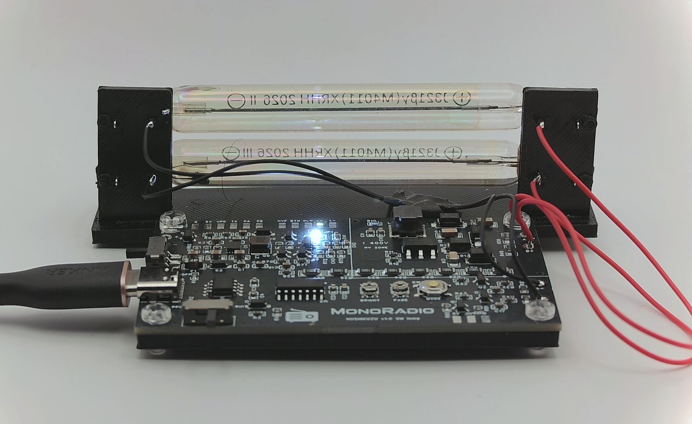
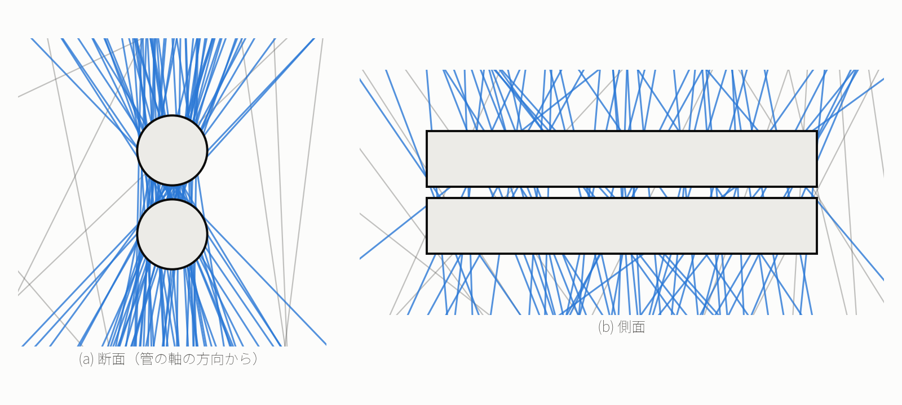
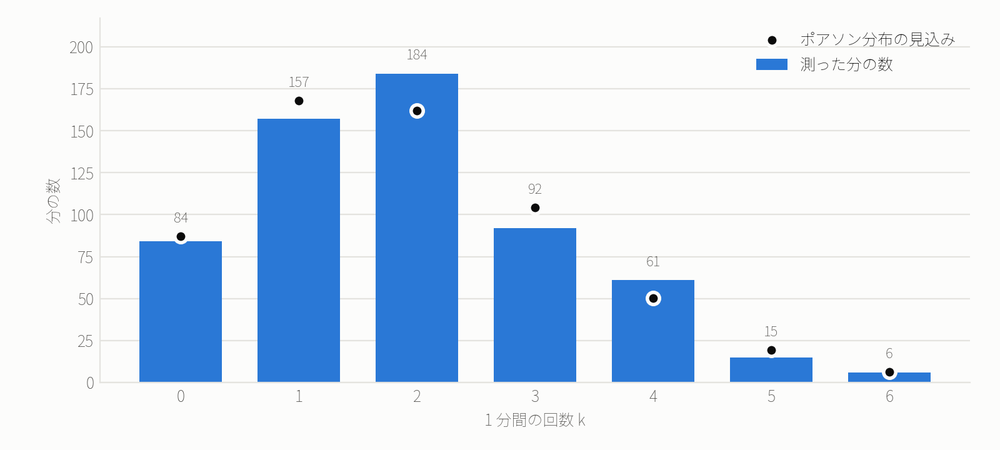
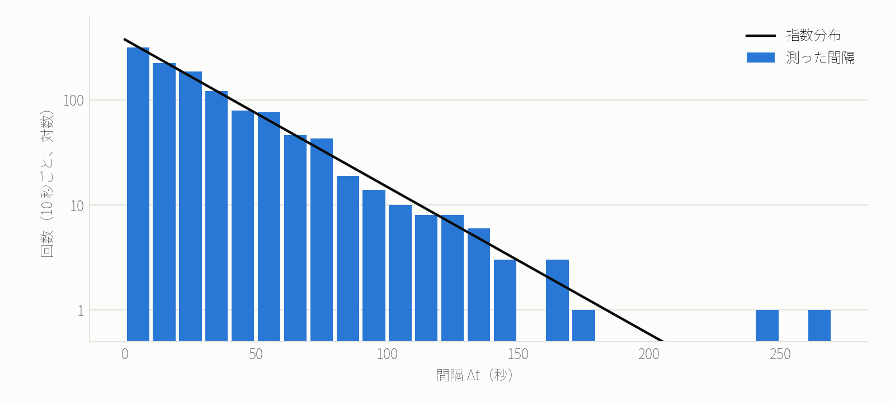
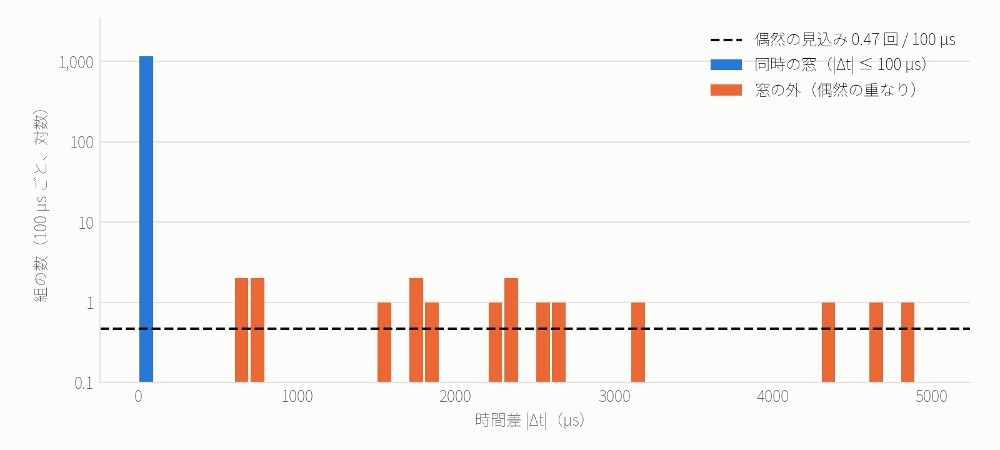
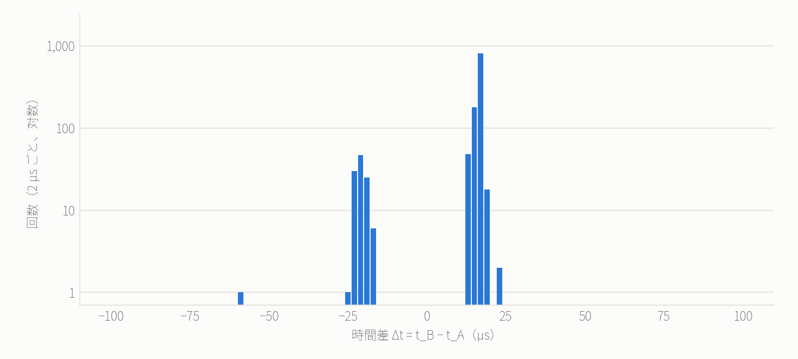
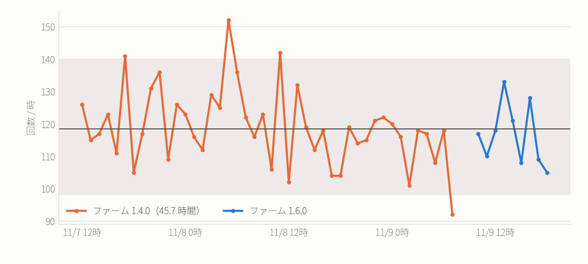
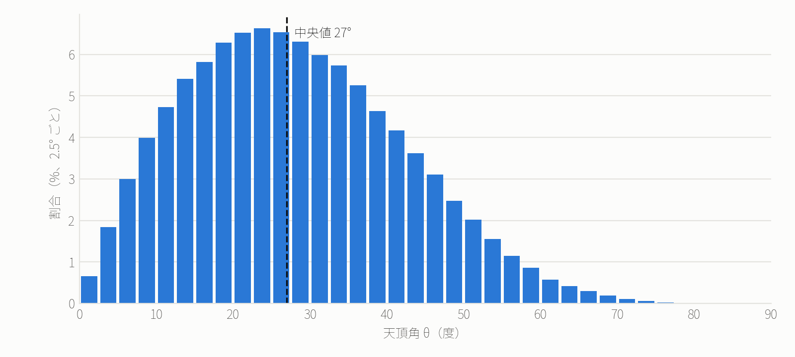
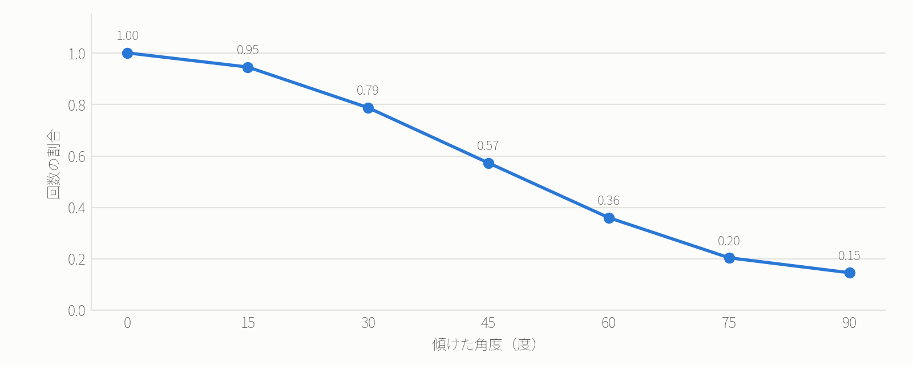

<div align="center">

<h1>卓上ガイガー＝ミュラー管コインシデンス灯<br>「星屑灯」による宇宙線ミューオンの計測</h1>

<p><i>Measuring cosmic-ray muons with a desktop Geiger–Müller coincidence lamp</i></p>

<p>MONORADIO　·　2026 年 11 月</p>

</div>

---

### 要旨

上下に重ねた 2 本のガイガー＝ミュラー（GM）管が同時に反応したときだけ光るランプ「星屑灯」を、宇宙線ミューオンの計数器として評価した。屋内の机上で 10.0 時間の連続観測を行い、1,162 事象の同時計数を得た。計数率は $`R = `$ 1.94 ± 0.06 min⁻¹ である。1 分ごとの計数はポアソン分布に（χ² 検定 p = 0.1）、到来間隔は指数分布に（KS 検定 p = 0.4）従い、到来が独立な事象の列であることを確かめた。偶然同時計数は理論式 $`R_\mathrm{acc} = 2\tau R_A R_B`$ どおりで、全体の 0.04% にとどまる。管の寸法と天頂角分布 $`I(\theta) = I_0\cos^2\theta`$ から幾何学的因子をモンテカルロ法で求め、鉛直強度 $`I_0 = `$ 51.3〜72.5 m⁻² s⁻¹ sr⁻¹ を得た。この値は文献値（約 70）と整合する。ファームウェアの異なる 45.7 時間の観測（同じ放電の二重計数を補正）とも、計数率は誤差の範囲で一致した。

**Abstract** — We evaluate a decorative lamp that lights only when two stacked Geiger–Müller tubes fire together as a cosmic-ray muon counter. A 10-hour run on a desk indoors gave 1,162 coincidences, a rate of 1.94 ± 0.06 per minute. Counts per minute follow a Poisson distribution and the waiting times an exponential one; chance coincidences agree with $`2\tau R_A R_B`$ and amount to 0.04%. A Monte Carlo of the tube geometry with a $`\cos^2\theta`$ angular distribution gives a vertical intensity of 51.3–72.5 m⁻² s⁻¹ sr⁻¹, consistent with the accepted value of about 70.

**キーワード**: 宇宙線、ミューオン、ガイガー＝ミュラー計数管、同時計数法、ポアソン過程、幾何学的因子

---

## 1. はじめに

一次宇宙線は、主に銀河内の超新星残骸で加速された陽子や原子核である。これが上空 15 km 前後で大気の原子核と衝突し、π 中間子を経てミューオンが生まれる。地上に届く荷電粒子の大部分はこのミューオンであり、水平な面 1 cm² あたり毎分およそ 1 個が通過する [1]。

ミューオンを数える古典的な方法は、2 つ以上の検出器を重ね、すべてが同時に反応した事象だけを選ぶ**同時計数法**である。単独の GM 管は環境のガンマ線にも反応するが、2 本を同時に貫く粒子は、地上ではほぼミューオンに限られる。

星屑灯は、この同時計数をアナログ回路で行い、その結果を LED の光として見せる照明である。本研究の目的は、この装置が光るだけのオブジェではなく、定量的な測定器として使えることを示すことにある。具体的には次の 4 点を報告する。

1. 到来の統計（ポアソン過程）の検証
2. 偶然同時計数の理論式の検証
3. 管の幾何からの計数率の予言と、鉛直強度の推定
4. 2 回の観測による再現性の確認

## 2. 装置と方法

### 2.1 検出器

<div align="center">

</div>

**図 1.** 星屑灯。上下に重ねた 2 本の GM 管（奥）と、同時計数の瞬間に光る基板（手前）。

検出器は GM 管 J321 を 2 本、軸を水平にして上下に重ねたものである（表 1）。高圧はブースト回路と倍電圧回路で作り、マイコンが帰還をかけて 360 V に保つ。

**表 1.** 検出器と観測の条件

| 項目 | 値 |
|---|---|
| GM 管 | J321 × 2（外径 10 mm、ガラス長 70 mm） |
| 配置 | 軸を水平にして上下に重ねる。中心間隔 約 12 mm |
| 印加電圧 | 360 V（観測 B の実測 359.2〜360.1 V） |
| 同時の窓 | $`\tau = 100\ \mu\mathrm{s}`$ |
| 不感時間 | $`\tau_d = 200\ \mu\mathrm{s}`$（管ごと、ファームウェア 1.5.0 以降） |
| 場所 | 屋内、机の上（建物の中） |

<picture>
  <source media="(prefers-color-scheme: dark)" srcset="figures/detector_dark.png">
  
</picture>

**図 2.** 検出器の幾何。モンテカルロで発生させた直線のうち、2 本の管を両方とも通るもの（青、計数される）と、そうでないもの（灰）。(a) 管の軸方向から見た断面、(b) 側面。

### 2.2 同時計数と計数系

同時計数は 2 段で行う。

- **アナログ（光）**: 2 本の管のパルスが時間的に重なっている間だけ、2 段の PNP トランジスタを通してコンデンサに電荷が入り、LED が光る。窓はパルスの重なりで決まり、約 0.1 ms である
- **デジタル（計数）**: マイコン（ATtiny1614）が各管のパルスの立ち下がりを割り込みで捉え、時刻を µs 単位で記録する。2 本の時間差が $`|\Delta t| \le \tau`$ のとき同時計数とする。あわせて、窓を 1 ms ずらした遅延同時計数 $`D`$ を数え、偶然同時計数の監視に使う

同じ管のパルスが、直前に数えたパルスから $`\tau_d = 200\ \mu\mathrm{s}`$ 以内に来た場合は、同じ放電の再パルスとみなして数えない（不感時間、ファームウェア 1.5.0 以降）。非まひ型の不感時間による数え落としは、真の計数率を $`n`$、観測した計数率を $`m`$ として $`n = m/(1 - m\tau_d)`$ で補正できる [4]。単独の管で 20 min⁻¹ でも $`m\tau_d \approx 7\times10^{-5}`$ であり、補正は無視できる。

本論文の数値はすべてデジタルの計数による。

### 2.3 データ取得

基板を USB で小型 PC に接続し、次の 3 種類を記録した。

1. 10 秒ごとの集計: 高圧、管 A・B の計数、同時計数 $`C`$、遅延同時計数 $`D`$
2. 反応 1 回ごとの事象: 種類（A・B・C）と PC 側の時刻（ms）
3. 2 本の時間差: $`|\Delta t| \le 5\ \mathrm{ms}`$ の組について、基板側で測った $`\Delta t = t_B - t_A`$（µs）

観測は 2 回行った（表 2）。主な結果は観測 B による。観測 A は 3.6 節で、再現性の確認に用いる。

**表 2.** 観測

| | ファームウェア | 期間（JST） | 時間 |
|---|---|---|---|
| 観測 A | 1.4.0 | 2026-11-07T11:01:20 〜 2026-11-09T08:45:21 | 45.7 h |
| 観測 B | 1.6.0 | 2026-11-09T09:30:51 〜 2026-11-09T19:30:48 | 10.0 h |

どちらの観測でも、10 秒ごとの記録に 25 秒を超える欠落はなかった。

## 3. 結果

### 3.1 計数率

**表 3.** 計数と計数率（観測 B）

| | 計数 | 計数率 [min⁻¹] |
|---|---:|---:|
| 同時計数 $`C`$ | 1,162 | **1.937 ± 0.057** |
| 管 A | 10,302 | 17.17 |
| 管 B | 8,130 | 13.55 |
| 遅延同時計数 $`D`$ | 1 | — |

単独の計数は、大部分が環境のガンマ線による。

### 3.2 到来の統計

到来が互いに独立で、計数率 $`R`$ が一定なら、時間 $`\Delta T`$ の計数 $`k`$ はポアソン分布に従い、到来間隔 $`\Delta t`$ は指数分布に従う。

```math
P(k) = \frac{\lambda^{k}\, e^{-\lambda}}{k!}, \qquad \lambda = R\,\Delta T \qquad\qquad (1)
```

```math
p(\Delta t) = R\, e^{-R\,\Delta t}, \qquad \langle \Delta t \rangle = \frac{1}{R}, \qquad \Delta t_{1/2} = \frac{\ln 2}{R} \qquad\qquad (2)
```

<picture>
  <source media="(prefers-color-scheme: dark)" srcset="figures/poisson_dark.png">
  
</picture>

**図 3.** 1 分ごとの同時計数の分布（599 分）。棒が実測、点が式 (1) の予測（$`\lambda = `$ 1.93）。

<picture>
  <source media="(prefers-color-scheme: dark)" srcset="figures/intervals_dark.png">
  
</picture>

**図 4.** 同時計数の到来間隔の分布（1,161 個、縦軸は対数）。線は式 (2) の予測。

1 分ごとの計数の平均は 1.93、分散は 1.765 で、ポアソン分布の性質 $`\sigma^2 = \lambda`$ に合う。分布全体の χ² 検定は χ² = 9.2（自由度 5、p = 0.1）であった。到来間隔の平均は 31.0 s、中央値は 22.3 s で、式 (2) の $`\Delta t_{1/2} = `$ 21.5 s と一致する。指数分布との KS 検定は p = 0.4 であった。どちらの検定でも、独立な到来という仮説は棄却されない。

### 3.3 偶然同時計数

互いに無関係な 2 本の反応が、たまたま窓に入る率は

```math
R_\mathrm{acc} = 2\,\tau\, R_A\, R_B \qquad\qquad (3)
```

である。観測 B では、窓の中の偶然同時計数の期待値は 0.47 事象で、同時計数全体の 0.04% にあたる。

式 (3) は直接確かめられる。窓の外（$`0.1 < |\Delta t| \le 5`$ ms）の組はすべて偶然の重なりなので、時間差の分布は平らになり、その高さは式 (3) で決まる（図 5）。窓の外の組は実測 17 組、予測 22.8 組であった。遅延同時計数 $`D`$ も、予測 0.94 事象に対して実測 1 事象で、式 (3) と整合する。

<picture>
  <source media="(prefers-color-scheme: dark)" srcset="figures/coincidence_dark.png">
  
</picture>

**図 5.** 2 本の管の時間差 $`|\Delta t|`$ の分布（0〜5 ms、100 µs ごと、縦軸は対数）。最初のビン（青）が同時の窓。破線は式 (3) から求めた偶然同時計数の高さ。

### 3.4 時間差分布

<picture>
  <source media="(prefers-color-scheme: dark)" srcset="figures/dt_dark.png">
  
</picture>

**図 6.** 窓の中の時間差 $`\Delta t = t_B - t_A`$ の分布（2 µs ごと、縦軸は対数）。

ミューオンは約 12 mm 離れた 2 本の管を 0.04 ns で通り抜ける。一方、測った時間差の中央値は +16 µs で、同時計数の 89% が +9〜+17 µs に集まる（図 6）。この差は粒子の飛行時間ではなく、マイコンが 2 本の割り込みを順に処理する時間による。

2 本の管の信号は同じポートの割り込みで受け、マイコンは管 A から順に処理する。そのため $`\Delta t`$ は管 A の処理時間だけ正にずれる（平均 +15.8 µs）。管 B がわずかに早く立ち下がると処理の順が入れ替わり、−21.4 µs 付近に小さな山（全体の 9.5%）ができる。

### 3.5 時間的な安定性

<picture>
  <source media="(prefers-color-scheme: dark)" srcset="figures/hourly_dark.png">
  
</picture>

**図 7.** 1 時間ごとの同時計数。帯はポアソン分布で 95% が入る範囲、線は平均。観測 A は 3.6 節の補正を施した値。

観測 B の 1 時間ごとの計数は平均 116.6 で、ばらつきの χ² は 6.3（自由度 8、p = 0.62）であった。観測 A（補正後）も χ² = 49.9（自由度 43、p = 0.22）で、統計的な揺れを超える変化は見られない。

### 3.6 2 回の観測の比較

観測 A は、不感時間を入れる前のファームウェア（1.4.0）で行った。その事象列には、10 ms 以内に同時計数が 2〜4 回続く塊が 1 時間あたり 6.8 回あった。到来が独立なら、45 時間でおよそ 2 回しか起きない並びである。塊の中では、片方の管が最初のパルスから 20〜96 µs 遅れて再びパルスを出し、それが窓に入って同じミューオンを重ねて数えていた。時間差を 5 ms まで広げても、100 µs より外に再パルスの過剰はなかった。

補正前の計数率は 2.14 min⁻¹ で、1 時間ごとの計数のばらつきもポアソン分布より大きかった（χ² = 62.5、自由度 43、p = 0.027）。PC 側の時刻で 10 ms 以内に続いた反応を 1 回の放電にまとめると、χ² = 49.9（p = 0.22）でポアソンの揺れに収まり、計数率は 1.98 ± 0.03 min⁻¹ となった。不感時間を入れた観測 B の 1.94 ± 0.06 min⁻¹ とは、差が 0.7 σ で一致する（表 4）。観測 B では塊は 1 時間あたり 0.0 回、同じ管の 10 ms 以内の再反応は 5.1 回で、偶然に重なる期待値 4.8 回と変わらない。

**表 4.** 2 回の観測の比較

| | 観測 A（補正前） | 観測 A（補正後） | 観測 B |
|---|:---:|:---:|:---:|
| 同時計数率 [min⁻¹] | 2.14 | 1.98 ± 0.03 | 1.94 ± 0.06 |
| 1 時間ごとの χ²（自由度） | 62.5（43） | 49.9（43） | 6.3（8） |
| その p 値 | 0.027 | 0.22 | 0.62 |
| 10 ms 以内の同時計数の塊 [h⁻¹] | 6.8 | — | 0.0 |

平均値だけでは気づきにくい誤りも、事象ごとの時刻を残しておけば、3.2 節と同じ統計の検定で見つけて補正できる。

## 4. 幾何学的受け入れと鉛直強度

地上のミューオンの強度は、天頂角 $`\theta`$ に対して近似的に

```math
I(\theta) = I_0 \cos^2\theta \qquad\qquad (4)
```

と表される [1]。方向 $`(\theta, \phi)`$ について、2 本の管を両方とも通る直線の束を、その方向に垂直な面へ射影した面積を $`A_\perp(\theta, \phi)`$ とすると、計数率は次のようになる。

```math
R = \varepsilon \int_{\Omega} I(\theta)\, A_\perp(\theta,\phi)\, d\Omega = \varepsilon\, I_0\, G, \qquad G \equiv \int_{\Omega} \cos^2\theta\, A_\perp(\theta,\phi)\, d\Omega \qquad\qquad (5)
```

ここで $`\varepsilon`$ は検出効率と遮へいを含む係数である。幾何学的因子 $`G`$ は、水平面を通る直線を $`\cos^3\theta`$（強度 × 面への射影）の重みで発生させるモンテカルロ法で求めた（図 2、付録のコード）。GM 管の有感長は直接測れないので、ガラス長 7 cm と、両端の電極部を除いた 5 cm の 2 通りで計算した（表 5）。

**表 5.** 幾何学的因子と計数率の予測（$`I_0 = 70`$ m⁻² s⁻¹ sr⁻¹、$`\varepsilon = 1`$）

| 有感長 | $`G`$ [cm² sr] | 予測 [min⁻¹] | 実測 [min⁻¹] | 実測 / 予測 |
|:---:|:---:|:---:|:---:|:---:|
| 5 cm | 4.45 | 1.87 | 1.94 | 1.04 |
| 7 cm | 6.29 | 2.64 | 1.94 | 0.73 |

$`\varepsilon = 1`$ として式 (5) を逆に解くと、鉛直強度は $`I_0 = R/G = `$ 51.3〜72.5 m⁻² s⁻¹ sr⁻¹ となる。この範囲は文献値の約 70 m⁻² s⁻¹ sr⁻¹ [1] を含む。屋内の遮へいと検出効率による $`\varepsilon < 1`$ を考えると、整合的である。

<picture>
  <source media="(prefers-color-scheme: dark)" srcset="figures/zenith_dark.png">
  
</picture>

**図 8.** 計数されるミューオンの天頂角の分布（モンテカルロ、有感長 7 cm）。

計数されるミューオンの天頂角の中央値は 27° である（図 8）。強度は鉛直方向で最大だが、天頂付近の立体角 $`2\pi\sin\theta\,d\theta`$ が小さいため、分布の山は 20〜30° に来る。

計数率の予測と鉛直強度の系統誤差としては、(i) 有感長の不確かさ（表 5 の幅、約 ±17%）、(ii) 管の検出効率と屋内の遮へい（$`\varepsilon`$）、(iii) 中心間隔の測定誤差（1 mm で $`G`$ が約 8% 変わる）がある。PC 側の時刻は USB の遅延を含むが、ms 単位の解析（到来間隔、3.6 節の塊の判定）には影響しない。

## 5. 考察: 時間の遅れ

ミューオンの静止系での寿命は $`\tau_\mu = 2.197\ \mu\mathrm{s}`$ であり [1]、光速で飛んでも $`c\tau_\mu \approx `$ 659 m しか進めない。それでも上空 15 km で生まれたミューオンが地上で数えられるのは、特殊相対論の時間の遅れによる [2, 3]。エネルギー $`E`$ のミューオンについて

```math
\gamma = \frac{E}{m_\mu c^2}, \qquad L = \gamma \beta\, c\, \tau_\mu, \qquad \frac{N(h)}{N_0} = e^{-h/L} \qquad\qquad (6)
```

である。地上での典型的なエネルギー $`E \approx 4`$ GeV（$`m_\mu c^2 = 105.7`$ MeV）では $`\gamma \approx `$ 38、平均飛行距離 $`L \approx `$ 25 km となる（表 6）。

**表 6.** 高度 15 km から地上まで崩壊せずに届く割合（大気中のエネルギー損失は無視した概算）

| | 平均飛行距離 $`L`$ | $`N/N_0`$ |
|---|:---:|:---:|
| 時間の遅れがない場合 | 659 m | 1.3e-10 |
| 時間の遅れを考えた場合（$`\gamma \approx `$ 38） | 25 km | 0.55 |

本研究で得た毎分約 2 回の同時計数は、地上にミューオンが大量に届いていること、すなわち時間の遅れが実際に起きていることの、ささやかな証拠でもある。

## 6. 結論

装飾用のランプとして作った星屑灯が、宇宙線ミューオンの定量的な計数器として機能することを示した。

1. 同時計数率は 1.94 ± 0.06 min⁻¹ で、到来はポアソン過程に従う
2. 偶然同時計数は式 (3) どおりで、全体の 0.04% にとどまる
3. 管の幾何と $`\cos^2\theta`$ 分布からの予測は実測と整合し、鉛直強度 $`I_0 = `$ 51.3〜72.5 m⁻² s⁻¹ sr⁻¹ を得た
4. 事象ごとの記録の検定で計数系の二重計数を見つけて補正でき、補正後の 2 回の観測は誤差の範囲で一致した

## 7. 今後の研究

計数の相対統計誤差は $`\sigma_R/R = 1/\sqrt{N}`$ である。本装置 1 台では 1 日に約 2,789 事象を数え、1 日の計数率を ±1.9% で決められる。これを基準に、次の研究が可能である。

**天頂角分布の測定** — 2 本の並びを管の軸のまわりに角度 $`\alpha`$ だけ傾けると、受け入れる天頂角が変わる。式 (5) から予測した計数率の比を図 9 に示す。各角度で 1 日ずつ測れば、式 (4) の $`\cos^2\theta`$ を検証できる。

<picture>
  <source media="(prefers-color-scheme: dark)" srcset="figures/tilt_dark.png">
  
</picture>

**図 9.** 2 本の並びを傾けたときの計数率の比の予測（$`\alpha = 0°`$ が上下、90° が横並び）。

**気圧効果** — 計数率は気圧 $`P`$ とともに $`\Delta R/R = \beta\,\Delta P`$ で変わり、$`\beta`$ はおよそ −0.1〜−0.2 %/hPa とされる [5]。気圧センサーと並べて数週間記録すれば、$`\beta`$ を求められる。

**太陽活動** — 太陽の大きな噴出のあと、銀河宇宙線が数日にわたって数% 減ることがある（フォーブッシュ減少 [6]）。数台の計数を合わせれば、1 日の誤差を 1% 程度まで下げられる。

**空気シャワー** — 2 台を数 m 離して置き、同時に光る事象を探すことで、1 個の一次宇宙線から生じた粒子群を捉えられる。小さな管では頻度が低く、長時間の観測と時刻の同期が必要になる。

**場所による違い** — 地下、建物の上下の階、高地で測れば、上にある物質や大気の厚さによる計数率の変化を調べられる。

## データとコードの公開

| ファイル | 内容 |
|---|---|
| [`analyze.py`](analyze.py) | 解析、モンテカルロ、作図。`python analyze.py <記録のフォルダ>` で以下を再生成する（numpy・scipy・matplotlib） |
| [`results.json`](results.json) | 本文の数値すべて |
| [`data/coincidences_main.csv`](data/coincidences_main.csv) | 観測 B の同時計数の時刻（UNIX 秒） |
| [`data/hourly_main.csv`](data/hourly_main.csv)・[`data/hourly_before.csv`](data/hourly_before.csv) | 1 時間ごとの同時計数 |

回路図・基板・ファームウェアは本リポジトリの [`hardware/`](../../hardware/) と [`firmware/`](../../firmware/stardust/) にある。反応 1 回ごとの元の記録は含めていない。

## 参考文献

1. S. Navas *et al.* (Particle Data Group), "Review of Particle Physics," *Phys. Rev. D* **110**, 030001 (2024) — Cosmic rays.
2. B. Rossi and D. B. Hall, "Variation of the Rate of Decay of Mesotrons with Momentum," *Phys. Rev.* **59**, 223 (1941).
3. D. H. Frisch and J. H. Smith, "Measurement of the Relativistic Time Dilation Using μ-Mesons," *Am. J. Phys.* **31**, 342 (1963).
4. G. F. Knoll, *Radiation Detection and Measurement*, 4th ed. (Wiley, 2010).
5. L. I. Dorman, *Cosmic Rays in the Earth's Atmosphere and Underground* (Springer, 2004).
6. S. E. Forbush, "On the Effects in Cosmic-Ray Intensity Observed During the Recent Magnetic Storm," *Phys. Rev.* **51**, 1108 (1937).
